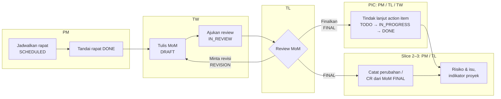
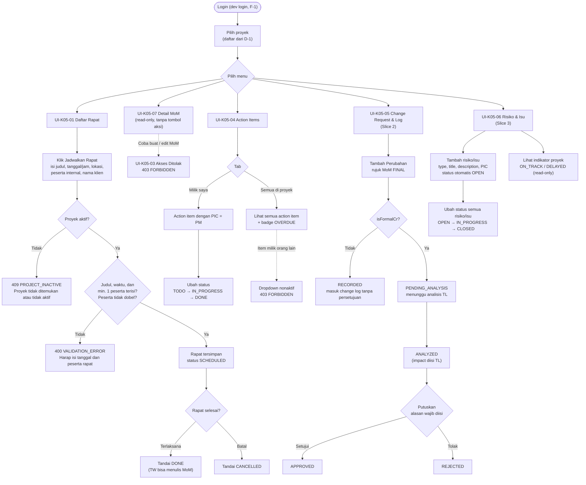
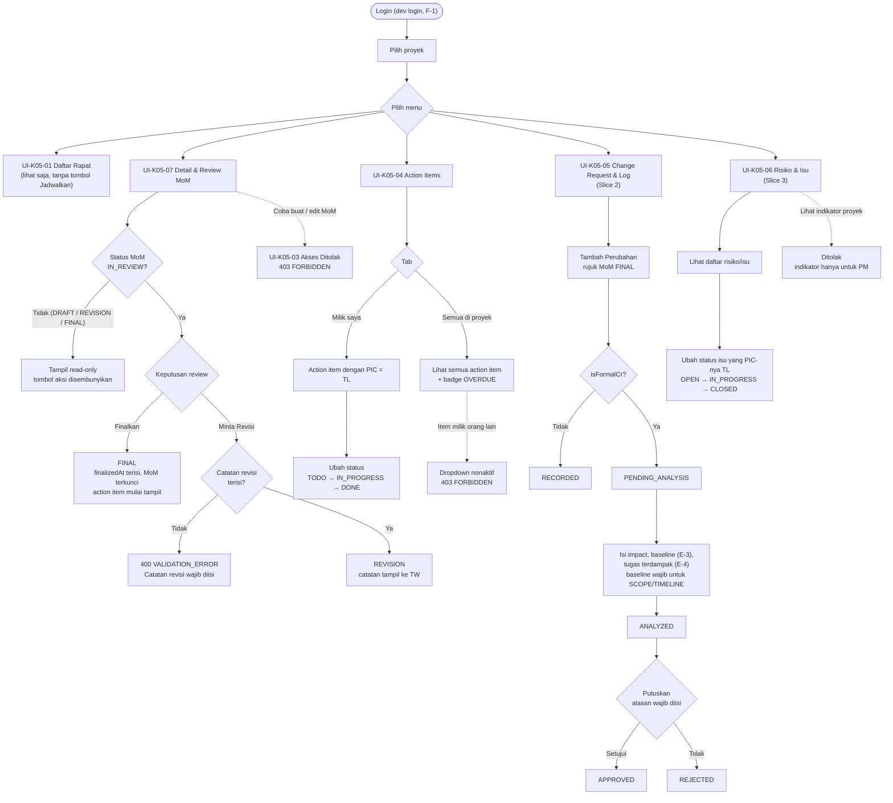
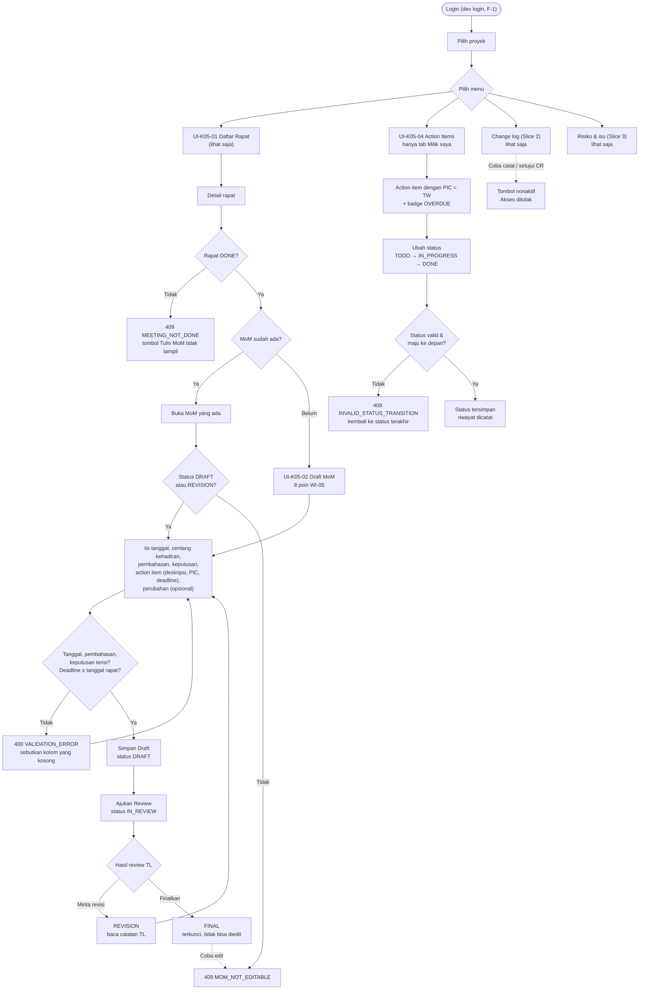
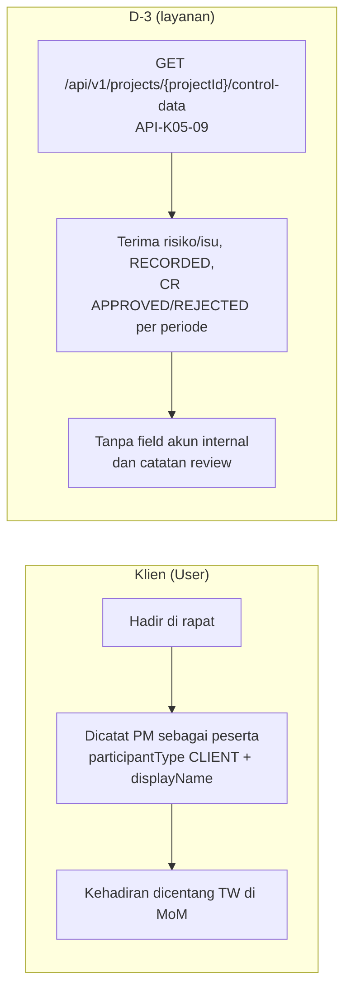
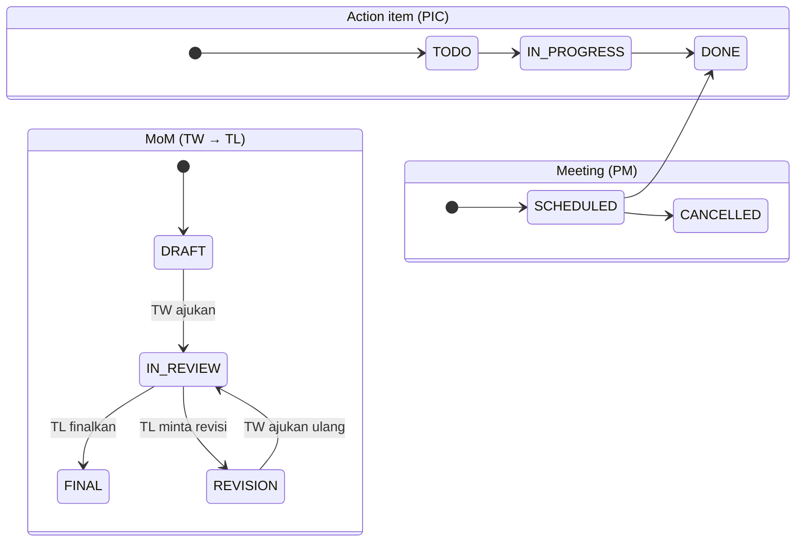

# Flow per Role — Modul E-5

Diagram alur kerja tiap role di E-5. Disusun dari tiga dokumen di folder ini:

- [PRD.md](PRD.md) v0.3: user story, status, dan matriks izin (§5, §6, §11)
- *Hak Akses per Role — Modul E-5.pdf*: matriks akses per fitur dan ringkasan per role
- *Rancangan_Antarmuka_E5_v0.2.pdf*: layar UI-K05-01 s.d. UI-K05-07 beserta validasinya

Kode layar `UI-K05-xx` merujuk ke Rancangan Antarmuka. Kode error mengikuti `openapi.yaml`.
Bagian yang ditandai **Slice 2** atau **Slice 3** belum dibangun di slice 1.

---

## 1. Alur besar (semua role)

Urutan SOP-06: Weekly Meeting → User Discussion → TW → MoM → Change/Adjustment → TL Analysis.

---

## 2. PM (Project Manager)

PM menjadwalkan rapat dan menutupnya, membaca semua data proyeknya, dan menjadi PIC action item
jika ditunjuk. PM **tidak** boleh menulis, mengedit, atau memfinalkan MoM.

---

## 3. TL (Technical Lead)

TL mereview MoM, membaca semua action item proyeknya, menganalisis dampak CR, dan ikut
memutuskan CR. TL **tidak** boleh membuat rapat, menulis MoM, atau mencatat risiko/isu baru.

---

## 4. TW (Technical Writer)

TW menulis MoM, menandai kehadiran, membuat action item di dalam MoM, lalu mengajukan review.
TW hanya melihat action item miliknya. TW **tidak** boleh membuat rapat, memfinalkan MoM,
mencatat atau memutuskan perubahan, atau mengelola risiko/isu.

---

## 5. Klien dan D-3

Keduanya tidak login ke E-5.

---

## 6. Status yang dipakai di semua flow

Setiap perubahan status dicatat otomatis di `StatusHistory` (siapa, kapan, dari/ke, catatan).
Riwayat tidak bisa diubah atau dihapus oleh siapa pun.

---

## 7. Perbedaan antar dokumen (perlu dikonfirmasi)

Flow di atas mengikuti PRD untuk slice 1 dan dokumen Hak Akses untuk slice 2–3. Beberapa aturan
tidak sama di ketiga dokumen:

| Topik | PRD v0.3 | Hak Akses | Rancangan Antarmuka v0.2 |
|---|---|---|---|
| Siapa membaca MoM | Semua anggota proyek | PM semua; TL/TW hanya MoM yang dia ikuti atau PIC | PM dan TW baca di UI-K05-07 |
| Siapa mencatat risiko/isu | PM (§3, slice 3) | Hanya PM | PM/TL (validasi UI-K05-06) |
| TW melihat change log dan risiko/isu | Belum dibahas | Boleh lihat | UI-K05-05 dan UI-K05-06 hanya PM, TL |
| Indikator proyek | Belum dibahas | Belum dibahas | Hanya PM |
| Kolom Change/Adjustment di MoM | Opsional | — | Wajib atau dikonfirmasi nihil |
